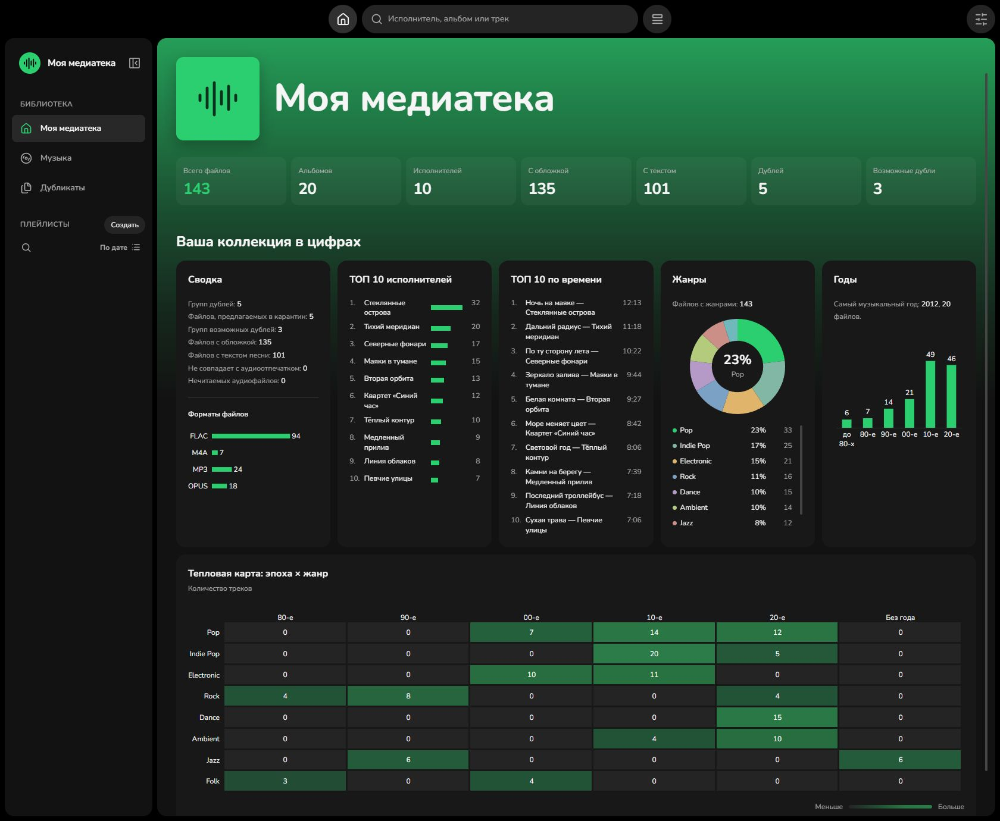

# Music Library Agent

Локальный инструмент для анализа музыкальной коллекции, поиска дублей и тегирования через beets. В веб-отчёте есть статистика, поиск по трекам, плеер с очередью, плейлисты и сравнение файлов в группах дублей.



*Демонстрационные данные.*

## Запуск из исходников

Установите Python 3.12. Из корня проекта выполните команды, подставив путь к своей библиотеке.

```powershell
python -m pip install -r requirements.txt
python scripts/report_server.py --library "D:\Music\Sorted" --open
```

При первом запуске сервер сканирует библиотеку и создаёт `reports/library.html` с CSV-отчётами. Страница доступна по [локальному адресу](http://127.0.0.1:8765/reports/library.html). Для смены папки откройте **Настройки → Источник музыки**.

## Запуск через Docker

Откройте PowerShell в корне проекта и подставьте папку, доступную Docker Desktop. Используйте тег из [Docker Hub](https://hub.docker.com/r/snikitinde/music-library/tags).

```powershell
$musicPath = 'D:\Music\Sorted'
$reportPath = Join-Path (Get-Location).Path 'reports'

docker run --rm -p 127.0.0.1:8765:8765 `
  --mount "type=bind,source=$musicPath,target=/music,readonly" `
  --mount "type=bind,source=$reportPath,target=/app/reports" `
  snikitinde/music-library:sha-c5d3f9a `
  python scripts/report_server.py --host 0.0.0.0 --library /music
```

Откройте [локальный отчёт](http://127.0.0.1:8765/reports/library.html). Папка музыки подключается только для чтения. Отчёты и состояние плеера сохраняются в `reports/`.

## Проверка и карантин

Веб-интерфейс по умолчанию работает в режиме проверки. «Найти дубли» обновляет отчёт. Перенос файла в карантин требует режима «Применить изменения» и отдельного подтверждения.

Для проверки из терминала:

```powershell
python scripts/find_duplicates.py --library "D:\Music\Sorted" --dry-run
```

Просмотрите `reports/duplicates.csv` и `reports/duplicates_needs_review.csv`. Особое внимание уделите концертным записям, ремастерам и разным версиям трека. После проверки укажите папку карантина для дублей с более низким рейтингом.

```powershell
python scripts/find_duplicates.py --library "D:\Music\Sorted" --quarantine "D:\Music\Duplicates"
```

## Теги через beets

Укажите `directory` и `library` в [beets-config.yaml](beets-config.yaml). Для поиска по аудиоотпечатку добавьте `fpcalc` из Chromaprint в `PATH`. Начните с небольшой папки для проверки.

```powershell
beet -c beets-config.yaml import "D:\Music\Unsorted"
```

В конфигурации включено копирование. beets записывает теги в копии в целевой папке.

## Отчёты и ссылки

HTML-отчёт открывается автономно. Для воспроизведения и действий с файлами нужен локальный сервер. HTML и CSV содержат пути и метаданные вашей коллекции. Для демонстрации используйте [пример CSV](examples/duplicate_report_example.csv).

[История изменений](CHANGELOG.md) · [Лицензии компонентов](THIRD_PARTY_NOTICES.md)
