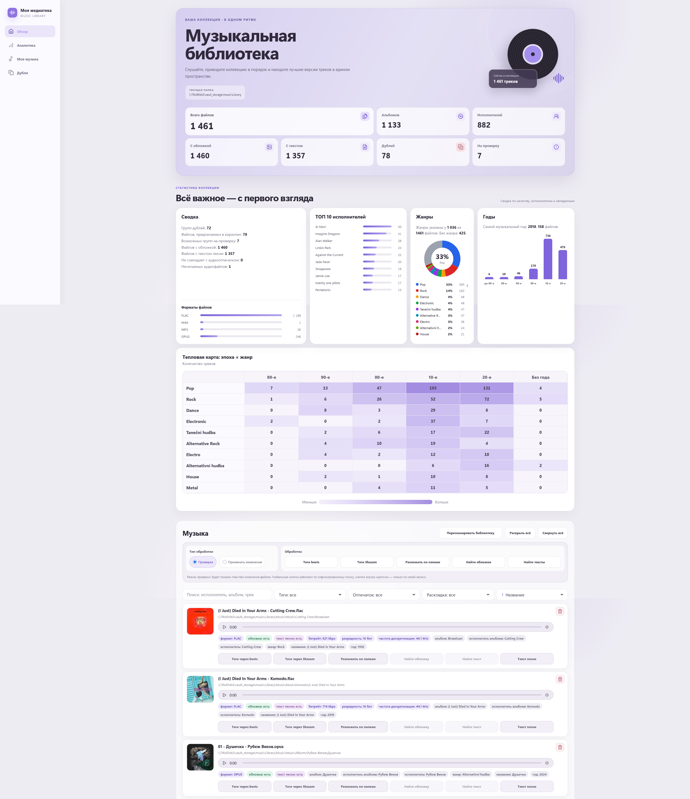
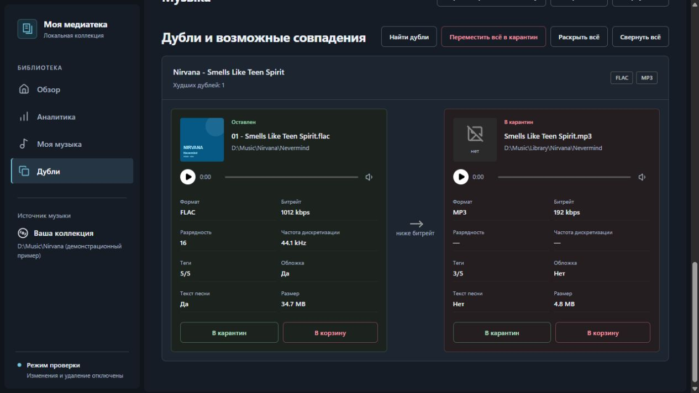

# Music Library Agent

Набор файлов для безопасной обработки музыкальной библиотеки через `beets` и вспомогательные скрипты.

## Примеры HTML-отчёта

### Обзор музыкальной библиотеки



### Дубли и возможные совпадения



## Что умеет

- Тегировать музыку через MusicBrainz.
- Раскладывать файлы по исполнителям и альбомам.
- Искать дубли по тегам.
- Оставлять файл с лучшим качеством.
- Переносить худшие дубли в карантин.
- Делать CSV- и автономный HTML-отчёты.
- Показывать статистику коллекции и управлять безопасными операциями через локальный веб-интерфейс.

## Важное правило

Скрипты не должны сразу удалять файлы.

Безопасный сценарий:

```text
исходники остаются на месте
↓
обработанная музыка копируется в Sorted
↓
дубли переносятся в Duplicates
↓
пользователь проверяет отчёт
↓
только потом вручную удаляет лишнее
```

## Установка

```bash
pip install -r requirements.txt
```

## Настройка beets

Открой файл:

```text
beets-config.yaml
```

И поменяй пути:

```yaml
directory: D:\Music\Sorted
library: D:\Music\beets.db
```

## Тегирование и раскладка музыки

```bash
beet -c beets-config.yaml import "D:\Music\Unsorted"
```

По умолчанию конфиг настроен безопасно:

```yaml
copy: yes
move: no
write: yes
timid: yes
```

Это значит:

- исходные файлы не будут удалены;
- обработанные файлы будут скопированы;
- теги будут записаны в копии;
- спорные совпадения потребуют подтверждения.

## Поиск корректных тегов по аудио-отпечатку

Если имя файла или старые теги вообще не соответствуют песне, например файл подписан одним исполнителем, а на слух это другая группа, используй fingerprint-поиск через MusicBrainz/AcoustID.

В конфиге включены плагины:

```yaml
plugins:
  - chroma
  - musicbrainz
```

Для работы нужны Python-зависимости из `requirements.txt` и утилита `fpcalc.exe` из Chromaprint в `PATH`. После этого обычный безопасный импорт сможет искать кандидатов по звучанию файла, а не только по текущим тегам:

```bash
beet -c beets-config.yaml import "D:\Music\Unsorted"
```

Для проверки одного проблемного файла сначала копируй его в отдельную тестовую папку и запускай импорт на этой папке. В конфиге включён `timid: yes`, поэтому спорные совпадения потребуют подтверждения.

## Поиск дублей

Только проверка:

```bash
python scripts/find_duplicates.py --library "D:\Music\Sorted" --dry-run
```

Перенос худших дублей в карантин:

```bash
python scripts/find_duplicates.py --library "D:\Music\Sorted" --quarantine "D:\Music\Duplicates"
```

С указанием отчёта:

```bash
python scripts/find_duplicates.py --library "D:\Music\Sorted" --quarantine "D:\Music\Duplicates" --report "reports\duplicates.csv"
```

## Как выбирается лучший файл

Приоритет:

1. FLAC / ALAC / WAV / AIFF.
2. Выше bitrate.
3. Выше bit depth.
4. Выше sample rate.
5. Больше заполненных тегов.
6. Есть встроенная обложка.
7. Больше размер файла.

## Что проверять руками

Перед удалением карантина проверь:

- remaster;
- deluxe edition;
- live;
- radio edit;
- explicit / clean;
- сборники;
- OST;
- разные релизы одного альбома.

## Полезные ссылки

- beets: https://beets.io/
- документация beets: https://beets.readthedocs.io/
- MusicBrainz Picard: https://picard.musicbrainz.org/

## Атрибуция

- Иконки действий основаны на [Lucide Icons 1.28.0](https://lucide.dev/); применяются лицензия ISC и лицензия MIT для иконок, происходящих из Feather. Полные уведомления находятся в [THIRD_PARTY_NOTICES.md](THIRD_PARTY_NOTICES.md) и встраиваются в каждый автономный HTML-отчёт.
- Знак с вертикальными звуковыми линиями в шапке и SVG-favicon также основаны на Lucide.
- Основной шрифт — [Nunito](https://github.com/googlefonts/nunito), SIL Open Font License 1.1. WOFF2 и полная лицензия встраиваются в HTML; внешняя загрузка не требуется. Файлы и сведения об источнике находятся в `scripts/assets/`. Для прежних образцов сохранены файлы [Inter](https://github.com/rsms/inter) с его лицензией OFL.
- Графики форматов, исполнителей, жанров, эпох и тепловая карта используют [Plotly.js 4.2.0](https://github.com/plotly/plotly.js/releases/tag/v4.2.0), MIT. Библиотека, русская локализация и лицензия встроены в автономный HTML. Кольцевая и столбчатые диаграммы отрисовываются SVG. Файлы и контрольные суммы источников хранятся в `scripts/assets/Plotly-SOURCE.txt`.
- Сохранённый в репозитории прежний PNG-favicon: [Music icon](https://www.flaticon.com/free-icon/music_9325026?term=music&page=1&position=94&origin=search&related_id=9325026) by Freepik — Flaticon.

## Красивый HTML-отчёт

После поиска дублей можно собрать интерактивный HTML-отчёт:

```bash
python scripts/generate_html_report.py --csv "reports\duplicates.csv" --out "reports\library.html"
```

В отчёте есть:

- адаптивный интерфейс с тремя отдельными страницами: «Обзор», «Моя музыка» и «Дубли»;
- обзор коллекции с количеством файлов, альбомов, исполнителей, обложек, текстов и дублей;
- диаграммы по форматам, исполнителям, жанрам и годам;
- поиск по исполнителю, альбому и названию;
- сортировка;
- постоянно раскрытые список музыки и группы дублей на своих страницах;
- сравнение оставленного файла и файла в карантине;
- отображение формата, битрейта, разрядности, частоты дискретизации, тегов, обложки, текста песни из тегов или соседнего `.lrc` / `.txt` и размера;
- поиск отсутствующих обложек и текстов песен из карточки трека при работе через локальный сервер;
- встроенные SVG-иконки без внешних CSS, JavaScript и CDN-зависимостей.

HTML-файл автономный: его можно открыть в браузере без сервера.

На странице «Обзор» находятся только сводка и графики. «Моя музыка» содержит список треков, поиск, фильтры и обработку файлов; «Дубли» — поиск по группам, сравнение файлов и действия с дублями. На обеих страницах полноширинный поиск расположен сразу под заголовком. Фильтры музыки выровнены влево отдельной строкой, метки метаданных компактнее кнопок и оформлены единым приглушённо-зелёным цветом. Кнопок раскрытия и сворачивания нет. Прямые ссылки используют `#overview`, `#musicSection` и `#duplicates`; переходы назад/вперёд работают внутри одного автономного HTML. Фильтры сохраняются при переключении страниц.

При первом открытии «Моей музыки» отображаются 10 треков, в «Дублях» — 10 групп сравнения. Следующие порции по 10 добавляются при прокрутке к концу списка; также доступна кнопка «Показать ещё». Поиск, фильтры, сортировка и массовые действия работают со всем списком, включая ещё не показанные записи. После изменения фильтра или сортировки снова отображается первая порция; при переходе между разделами уже показанные карточки сохраняются. Подгрузка работает и без сервера: данные находятся в автономном HTML.

Окно текста песни открывается в режиме «Для чтения»: название и исполнитель показаны отдельно, служебные LRC-метки и таймкоды скрыты, сохраняются строки, строфы и обозначения частей песни. Режим «Исходный» показывает точный исходный текст с метками; путь и источник доступны в раскрывающемся блоке «О тексте». Это только оформление: тексты и музыкальные файлы не изменяются.

В отчёте один общий плеер, который появляется снизу после выбора песни. Клик по обложке, названию или свободной области карточки запускает или приостанавливает трек; с клавиатуры работают Enter и пробел на карточке. Кнопки обработки и текста выполняют только свои действия. В нижней панели находятся обложка, название/исполнитель, воспроизведение/пауза, предыдущий/следующий трек, позиция/длительность, громкость и открытие текста. Навигация сразу запускает соседний файл по списку, из которого выбрана песня, с учётом поиска и сортировки, включая неподгруженные записи; в дублях одинаковые пути не повторяются. На границах списка соответствующая кнопка отключена. Переходы между страницами и исчезновение карточки из фильтра не прерывают аудио.

Если текст содержит LRC-таймкоды, текущая строка подсвечивается и прокручивается вслед за общим плеером, когда в нём выбрана эта песня. Клик по строке выбирает песню и запускает воспроизведение с её начала; пауза и перемотка учитываются сразу. Ручная прокрутка приостанавливает следование, кнопка «К текущей строке» возвращает его. Нижний плеер доступен и при открытом тексте; отдельного плеера в окне нет. Само открытие окна музыку не запускает. Без таймкодов остаётся обычное чтение, в исходном виде подсветка отключена.

Если несколько строк имеют только одинаковые нулевые метки, отчёт показывает «Все таймкоды — 00:00» и режим чтения. Такие метки не содержат времени строк: подсветка всего текста и переходы к нулевой позиции отключены. Для караоке нужен LRC с настоящими таймкодами. Исходный текст остаётся доступным без изменений.

В «Дублях» файлы сравниваются в нейтральных карточках того же вида, что в «Моей музыке»: обложка, название, путь, плеер, таблица характеристик и действия. Лучшие значения каждого параметра выделены зелёным; равные и неизвестные остаются обычными. Битрейт сравнивается при одинаковом формате, размер — только при равных остальных характеристиках. Группы имеют читаемые названия из тегов или имён файлов. Спорные совпадения отмечены «Требует проверки»; их статус не меняется из-за оформления.

Если дублей несколько, оставляемый файл показан один раз слева, остальные — справа. На широком экране оставляемая карточка остаётся видимой при прокрутке группы; на узком файлы располагаются друг под другом. Зелёное значение слева означает преимущество хотя бы над одним из текущих дублей; справа — над оставляемым файлом. Поиск проверяет названия, исполнителей, альбомы, теги и пути всех файлов группы, включая ещё не подгруженные группы. После обработки одного дубля счётчик, поисковые данные и подсветка оставляемого файла обновляются.

На широком экране оба файла пары расположены рядом; одноимённые параметры, плееры и кнопки выровнены по горизонтали. На телефоне пара располагается вертикально. Полные названия и пути доступны в подсказках при наведении.

Жанровые графики используют проверенные названия и однозначные синонимы из `scripts/assets/genre-rules.json`, со ссылками на MusicBrainz и другие музыкальные справочники. Каждый трек учитывается один раз в каждом нормализованном жанре. Служебные категории и неподтверждённые подписи не включаются в графики; исходные теги и поиск по ним сохраняются. Незнакомые значения требуют проверки и не объявляются автоматически ошибочными.

Проверка всех жанров встроенного отчёта без сканирования музыкальных файлов:

```powershell
python scripts/audit_genres.py --html reports/library.html
```

Создаются `reports/genre_audit.csv` и JSON-сводка; только неподтверждённые случаи попадают в `reports/genre_audit_needs_review.csv`. При добавлении проверенного жанра или синонима в справочник достаточно перерисовать HTML.

### Выбор источника музыки

Нажмите «Источник» в нижнем блоке бокового меню, рядом с режимом проверки. Откроется окно с дисками и папками компьютера, на котором запущен сервер. Можно переходить по папкам, подниматься на уровень выше или вставить полный путь, включая UNC. Сам путь в боковой панели не выделяется и показывает курсор-указатель.

Под источником находится кнопка режима обработки: каждый клик переключает «Режим проверки» → «Применить изменения» → «Режим проверки». При открытии или перезагрузке отчёта выбран режим проверки. Переключение само по себе не запускает обработку; реальное действие по-прежнему требует отдельного подтверждения.

Во время сканирования показаны текущий этап, обработанные файлы, их количество и процент выполнения этапа. При поиске файлов и сборке отчёта, когда точное число шагов неизвестно, отображается индикатор ожидания. Проценты поступают из реального сканера; завершение отображается после успешного сохранения отчётов.

Кнопка «Выбрать и пересканировать» явно подтверждает смену источника. Дубли ищутся с `--dry-run`, отчёты готовятся во временной папке и заменяют прежние только после успешного завершения. Музыка и теги не изменяются. Предыдущие отчёты сохраняются в `reports/source_backups/`, действия записываются в `reports/source_actions.csv`, выбранный источник — в `reports/source.json`. При ошибке сохраняются прежний источник и отчёты.

Для запуска с источником из командной строки также доступно:

```powershell
python scripts/report_server.py --library "D:\Music\Sorted" --open
```

Если папка отличается от текущего отчёта, перед открытием страницы выполняется безопасная пересборка. Ключ `--library` у генератора отчёта также сохранён; новый отчёт, собранный этим ключом, имеет приоритет над прежним выбором в интерфейсе. Без сервера можно просматривать автономный HTML, но выбирать папки компьютера и менять источник нельзя.

### Поиск обложек и текстов песен

Запустите отчёт через локальный сервер:

```bash
python scripts/report_server.py --open
```

В карточках без метаданных появляются кнопки `Найти обложку` и `Найти текст`.

- тексты ищутся в LRCLIB, синхронизированный LRC имеет приоритет;
- релизы ищутся в MusicBrainz, изображения загружаются из Cover Art Archive;
- до записи показывается список кандидатов и требуется явное подтверждение;
- текст сохраняется рядом с треком как `<имя>.lrc` или `<имя>.txt`;
- обложка сохраняется рядом с альбомом как `cover.jpg` или `cover.png`;
- существующие файлы не перезаписываются, аудиофайлы и их теги не изменяются;
- каждая запись фиксируется в `reports/file_actions.csv`.

Поиск использует интернет только после нажатия соответствующей кнопки. Автономный HTML без сервера остаётся доступен только для просмотра уже найденных данных.

### Безопасная обработка и повторный поиск дублей

При запуске через `scripts/report_server.py` доступны два режима:

- `Проверка` — режим по умолчанию, который только показывает план и не меняет файлы;
- `Применить изменения` — требует отдельного подтверждения перед каждым реальным действием; удаление файлов запрещено.

Кнопка `Найти дубли` в разделе дублей повторно сканирует всю текущую библиотеку, обновляет CSV дублей и пересобирает HTML-отчёт. Сканирование не перемещает файлы и также требует явного подтверждения.

Глобальные действия применяются только к текущему отфильтрованному списку, а кнопки внутри карточки — только к файлу этой карточки.

Дополнительно:

- Верхняя панель отчёта не закреплена при прокрутке.
- Подписи технических параметров музыки в HTML-отчёте отображаются на русском.

## HTML-отчёт с анализом всей папки

Теперь HTML-отчёт может не только показывать дубли, но и анализировать всю музыкальную папку.

Команда:

```bash
python scripts/generate_html_report.py --csv "reports\duplicates.csv" --library "D:\Music\Sorted" --out "reports\library.html"
```

На странице отчёта будет показано:

- сколько всего аудиофайлов найдено в папке;
- сколько альбомов найдено по тегам `albumartist + album`;
- сколько исполнителей найдено по тегам `artist / albumartist`;
- сколько дублей найдено и сколько файлов предложено перенести в карантин;
- распределение файлов по форматам;
- текущий подробный отчёт по дублям.
