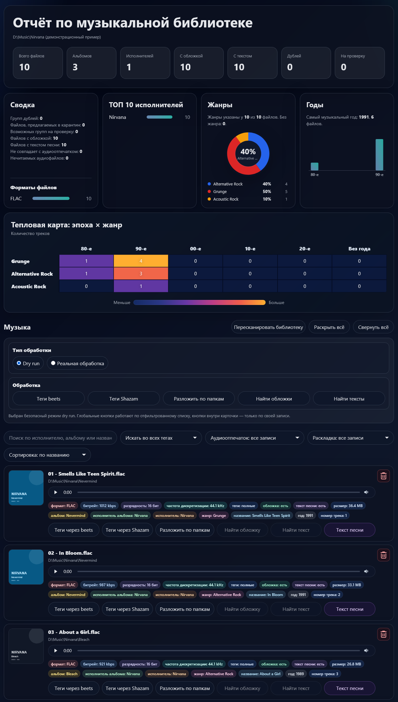

# Music Library Agent

Набор файлов для безопасной обработки музыкальной библиотеки через `beets` и вспомогательные скрипты.

## Пример HTML-отчёта



## Что умеет

- Тегировать музыку через MusicBrainz.
- Раскладывать файлы по исполнителям и альбомам.
- Искать дубли по тегам.
- Оставлять файл с лучшим качеством.
- Переносить худшие дубли в карантин.
- Делать CSV-отчёт.

## Важное правило

Скрипты не должны сразу удалять файлы.

Безопасный сценарий:

```text
исходники остаются на месте
↓
обработанная музыка копируется в Sorted
↓
дубли переносятся в Duplicates
↓
пользователь проверяет отчёт
↓
только потом вручную удаляет лишнее
```

## Установка

```bash
pip install -r requirements.txt
```

## Настройка beets

Открой файл:

```text
beets-config.yaml
```

И поменяй пути:

```yaml
directory: D:\Music\Sorted
library: D:\Music\beets.db
```

## Тегирование и раскладка музыки

```bash
beet -c beets-config.yaml import "D:\Music\Unsorted"
```

По умолчанию конфиг настроен безопасно:

```yaml
copy: yes
move: no
write: yes
timid: yes
```

Это значит:

- исходные файлы не будут удалены;
- обработанные файлы будут скопированы;
- теги будут записаны в копии;
- спорные совпадения потребуют подтверждения.

## Поиск корректных тегов по аудио-отпечатку

Если имя файла или старые теги вообще не соответствуют песне, например файл подписан одним исполнителем, а на слух это другая группа, используй fingerprint-поиск через MusicBrainz/AcoustID.

В конфиге включены плагины:

```yaml
plugins:
  - chroma
  - musicbrainz
```

Для работы нужны Python-зависимости из `requirements.txt` и утилита `fpcalc.exe` из Chromaprint в `PATH`. После этого обычный безопасный импорт сможет искать кандидатов по звучанию файла, а не только по текущим тегам:

```bash
beet -c beets-config.yaml import "D:\Music\Unsorted"
```

Для проверки одного проблемного файла сначала копируй его в отдельную тестовую папку и запускай импорт на этой папке. В конфиге включён `timid: yes`, поэтому спорные совпадения потребуют подтверждения.

## Поиск дублей

Только проверка:

```bash
python scripts/find_duplicates.py --library "D:\Music\Sorted" --dry-run
```

Перенос худших дублей в карантин:

```bash
python scripts/find_duplicates.py --library "D:\Music\Sorted" --quarantine "D:\Music\Duplicates"
```

С указанием отчёта:

```bash
python scripts/find_duplicates.py --library "D:\Music\Sorted" --quarantine "D:\Music\Duplicates" --report "reports\duplicates.csv"
```

## Как выбирается лучший файл

Приоритет:

1. FLAC / ALAC / WAV / AIFF.
2. Выше bitrate.
3. Выше bit depth.
4. Выше sample rate.
5. Больше заполненных тегов.
6. Есть встроенная обложка.
7. Больше размер файла.

## Что проверять руками

Перед удалением карантина проверь:

- remaster;
- deluxe edition;
- live;
- radio edit;
- explicit / clean;
- сборники;
- OST;
- разные релизы одного альбома.

## Полезные ссылки

- beets: https://beets.io/
- документация beets: https://beets.readthedocs.io/
- MusicBrainz Picard: https://picard.musicbrainz.org/

## Атрибуция

- Favicon: [Music icon](https://www.flaticon.com/free-icon/music_9325026?term=music&page=1&position=94&origin=search&related_id=9325026) by Freepik - Flaticon.

## Красивый HTML-отчёт

После поиска дублей можно собрать интерактивный HTML-отчёт:

```bash
python scripts/generate_html_report.py --csv "reports\duplicates.csv" --out "reports\library.html"
```

В отчёте есть:

- сводка по количеству групп и дублей;
- поиск по исполнителю, альбому и названию;
- сортировка;
- раскрывающиеся карточки;
- сравнение оставленного файла и файла в карантине;
- отображение формата, bitrate, bit depth, sample rate, тегов, обложки, текста песни из тегов или соседнего `.lrc` / `.txt` и размера.
- поиск отсутствующих обложек и текстов песен из карточки трека при работе через локальный сервер.

HTML-файл автономный: его можно открыть в браузере без сервера.

### Поиск обложек и текстов песен

Запустите отчёт через локальный сервер:

```bash
python scripts/report_server.py --open
```

В карточках без метаданных появляются кнопки `Найти обложку` и `Найти текст`.

- тексты ищутся в LRCLIB, синхронизированный LRC имеет приоритет;
- релизы ищутся в MusicBrainz, изображения загружаются из Cover Art Archive;
- до записи показывается список кандидатов и требуется явное подтверждение;
- текст сохраняется рядом с треком как `<имя>.lrc` или `<имя>.txt`;
- обложка сохраняется рядом с альбомом как `cover.jpg` или `cover.png`;
- существующие файлы не перезаписываются, аудиофайлы и их теги не изменяются;
- каждая запись фиксируется в `reports/file_actions.csv`.

Поиск использует интернет только после нажатия соответствующей кнопки. Автономный HTML без сервера остаётся доступен только для просмотра уже найденных данных.


Дополнительно:

- Верхняя панель отчёта не закреплена при прокрутке.
- Подписи технических параметров музыки в HTML-отчёте отображаются на русском.

## HTML-отчёт с анализом всей папки

Теперь HTML-отчёт может не только показывать дубли, но и анализировать всю музыкальную папку.

Команда:

```bash
python scripts/generate_html_report.py --csv "reports\duplicates.csv" --library "D:\Music\Sorted" --out "reports\library.html"
```

На странице отчёта будет показано:

- сколько всего аудиофайлов найдено в папке;
- сколько альбомов найдено по тегам `albumartist + album`;
- сколько исполнителей найдено по тегам `artist / albumartist`;
- сколько дублей найдено и сколько файлов предложено перенести в карантин;
- распределение файлов по форматам;
- текущий подробный отчёт по дублям.
